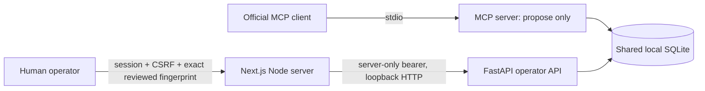

# SafeAction architecture

`arqon_os/mcp_server.py` uses the official SDK and explicitly exposes three tools.
Health is read-only. Mock agent runs reuse BasicAgent, ModelGateway, MockModelProvider,
AgentRuntime and SQLiteRunStore. Checklist proposal creation reuses
PersistentSafeActionWorkflow; MCP has only `checklist.propose`, never `checklist.save`,
and no human deciders or approval endpoints.

`arqon_os/safe_action.py` stores proposals and committed checklists in the same
operator-configured SQLite database. Canonical content fingerprints bind proposal
ID, title and exact items. Pending proposals expire after ten minutes. Decisions
reload and validate inside BEGIN IMMEDIATE. Approval uses the existing permission
and human approval manager, then atomically commits the checklist insert and
approved status. Rejection commits rejected status without a checklist. Unique
proposal/approval identifiers and terminal state checks prevent duplicate saves.

`arqon_os/api.py` requires the backend operator bearer and local peer checks for
operator routes. It returns only proposal data. The bearer is never a browser login.

`apps/web/lib/operator.ts` implements independent password verification, hashed
opaque session IDs, absolute expiry, revocation/logout, session CSRF and reviewed
fingerprints. Next.js forwards only allowlisted operations, attaching its backend
bearer server-side. `safe-action-client.ts` retains CSRF only in component memory;
`safe-action-panel.tsx` displays all items and requires review plus confirmation.

One persistent Node process owns the session map. No session replication, automatic
expiry extension, cloud storage, AI-driven tool calling, real inference or scanner
modules are included. Source provenance and exact release-local changes are listed
in docs/SOURCE_PROVENANCE.json. The recording launcher selects configurable isolated
interpreters and optionally starts a prebuilt frontend; application policy is reused.
