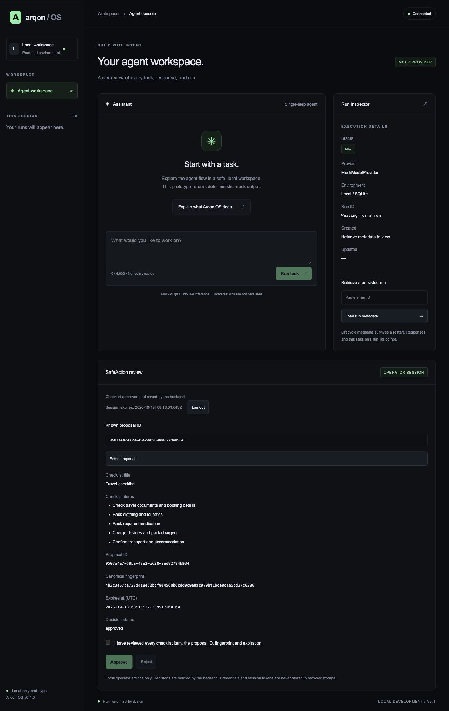
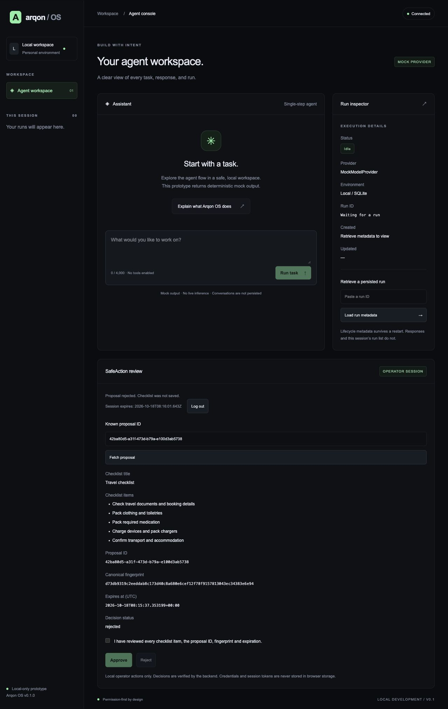

# Arqon SafeAction

> **SOURCE RELEASE CANDIDATE — ready for publication authorization.**
> MIT License: Copyright (c) 2026 Mounesh H Pattar. Owner attestations recorded; publication still requires separate authorization.

**An assistant proposes. A person reviews. Only the exact approved checklist is saved.**

This is a simulated Alexa+-style experience using an MCP-compatible architecture.
It is not a live Alexa+ integration. All demonstration information is synthetic.

## Problem and solution

Assistant-triggered actions need a clear boundary between proposing an action and
performing it. SafeAction prepares a bounded travel checklist through the official
MCP SDK. An independently authenticated local operator reviews its content and
fingerprint, then explicitly approves saving it or rejects it without saving.

## Features

- Exactly three MCP tools: `arqon_health`, `arqon_run_mock`, `arqon_propose_checklist`.
- Deterministic mock output and five-item synthetic travel proposals.
- Durable SQLite proposals with ten-minute expiry and atomic decisions.
- Local operator login, HttpOnly SameSite=Strict session cookies and session CSRF.
- Exact reviewed fingerprints; replay, tampering and unauthorized decision rejection.
- Next.js review UI with separate confirmation and visible decision status.
- No model credentials, real inference, scanner code, shell tools or Alexa+ connection.

## Architecture and stack

`Official MCP client → stdio server → SQLite ← FastAPI ← Next.js ← human review`

Python 3.13.5, official MCP SDK 1.30.0, FastAPI 0.115.6, SQLite (stdlib), Node 22,
Next.js 16.4.0, React 19.3.0 and TypeScript 5.9.3 (npm lockfile). See
[ARCHITECTURE.md](ARCHITECTURE.md) and [SECURITY.md](SECURITY.md).

## Installation and configuration

The archive contains source, not environments or downloaded dependencies. Use the
pinned **separate** Python profiles; the MCP and backend environments must not be
merged. MCP's newer Pydantic/Starlette differ from this tested backend profile.
Installation commands below are for the owner's later fresh setup; no dependencies
were installed during release preparation.

```sh
python3.13 -m venv .venv-backend
python3.13 -m venv .venv-mcp
.venv-backend/bin/python -m pip install -r requirements-backend.txt
.venv-mcp/bin/python -m pip install -r requirements-mcp.txt
cd apps/web
npm ci
cd ../..
```

Run from this package root; no editable install is required. The stdlib application
modules need no original Architect-VAPT directory. `.env.example` lists server-only
configuration names and placeholders. Prefer the launcher: it generates backend
credentials internally, prompts for a hidden independent password and creates
private temporary storage. Never load placeholder values as real credentials.

## Demo

```sh
.venv-mcp/bin/python -B -m examples.amazon_recording_demo
```

Wait for READY, then open the printed loopback URL. It creates fresh synthetic A/B
proposals. Follow [docs/AMAZON_DEMO.md](docs/AMAZON_DEMO.md) and the
[170-second video script](docs/AMAZON_VIDEO_SCRIPT.md). Ctrl-C or the instance's
printed STOP command closes only owned services and removes its temporary data.
No user approval is automated by the launcher.

For a production-build rehearsal, first run `npm run build` in `apps/web`, then add
`--production` to the launcher. This remains local-only and is not a deployment.

## Tests and production build

```sh
bash scripts/verify_local.sh
```

This runs only packaged relevant tests, TypeScript and the production build. It
needs the preinstalled environments above. Tests use mocks or controlled local
protocols; no live model invocation. See [release evidence](docs/RELEASE_READINESS.md)
for exact measured counts and remaining owner gates.

## Screenshots and recording

These screenshots come from the actual standalone production-build synthetic
browser rehearsal. UUIDs and timestamps vary each run. No video is
included or claimed.





Record the actual three-minute demonstration before submission.

## Limitations and release status

Local single operator and one persistent Node process; no public deployment,
voice/Alexa+ registration, remote MCP endpoint, model provider or travel booking.
Mock response history is not persisted. Demo data is deleted on launcher cleanup.
Sessions are in-memory. Database write access and same-OS-user compromise are
outside the application boundary. See [release checklist](docs/RELEASE_CHECKLIST.md).

## MIT license and publication status

[LICENSE](LICENSE) retains the complete MIT text and Copyright (c) 2026 Mounesh H
Pattar. The owner confirms original project code/publication permission, Arqon
branding permission and screenshot/visual redistribution rights. These are owner
attestations, not independently verified legal conclusions.

The scoped source-only review is **READY FOR PUBLICATION AUTHORIZATION**; see
[FINAL_RIGHTS_REVIEW.md](docs/FINAL_RIGHTS_REVIEW.md). No identified shipped
third-party notice/permission blocker remains. External dependencies are referenced,
not bundled, and retain their own terms; future builds need fresh notice review.

Separate owner authorization is still required before GitHub publication. Intended
repository: `arqon-safeaction`; prepared commands are in
[GITHUB_PUBLICATION_GUIDE.md](docs/GITHUB_PUBLICATION_GUIDE.md). Nothing was published.
